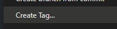

# Reglas para Github (GIT)

### Releases en github
Deberás crear workers de release en Github para que cada vez que se haga un commit en la rama principal, se genere automáticamente un release con el código actualizado. 

El nombre del release (el nombre del TAG) deberá ser el mismo que coloque en "Create Tag" de mi proyecto. Por ejemplo, si el nombre del tag es "v1.0.0", el release generado automáticamente deberá tener el mismo nombre.



Asi mismo, en la versión de plugin, deberás colocar el mismo nombre del tag. Por ejemplo, si el tag es "v1.0.0", la versión del plugin deberá ser "v1.0.0".

Para que el plugin sea válido, debe pasar por todas las pruebas y validaciones para todas las versiones Java disponibles. Desde la versión java predefinida en configuración (deberás escanear el proyecto y comprobar cual es el bytecode base) hasta la versión mas reciente de java. Por ejemplo, si el proyecto tiene como bytecode base Java 8, deberás probarlo en Java 8, 11, 16, 17, 21 y 25.

Por último, una vez validado, se crea una release en Github con el mismo nombre del tag y el jar del plugin con el siguiente formato: "nombre_del_plugin-vX.X.X.jar" (donde X.X.X es la versión del plugin obtenida del tag del release).

Como descripción de la release, deberás colocar lo siguiente:

```md
# ⚠️ Disclaimer!
This is a github release; we highly recommend you to download the plugin from SpigotMC.

# How to install (from Github)
1. Download the jar: `{nombre_del_plugin-vX.X.X.jar}`
2. Place it in your server's `plugins` folder.
3. Restart your server.
```

(Ignora el ```md ```, lo que importa es el contenido del texto, no el formato de markdown).

