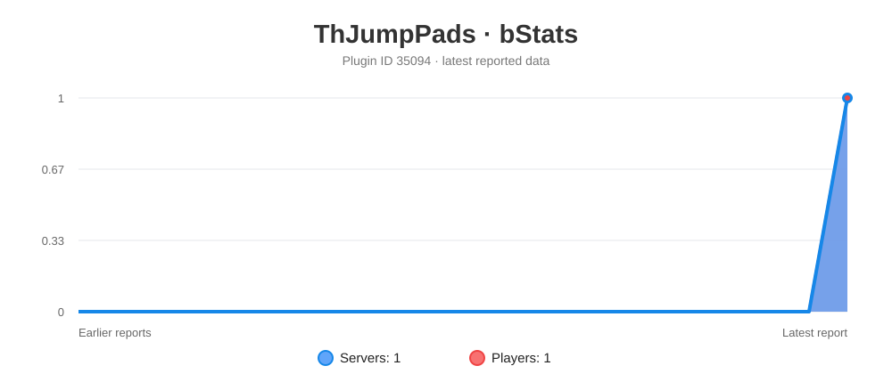

# Installation

1. Download the jar.
2. Place the jar in the `plugins` folder.
3. Reload the server.

# Dependencies

#### Soft Dependencies:
- [PlaceholderAPI](https://www.spigotmc.org/resources/placeholderapi.6245/): Used for placeholders in messages and commands. Also to register placeholders for the plugin.

# Commands and Permissions
| Command | Description | Permission |
|---|---|---|
| `/thjumppads toggle` | Enable or disable the jump pads use | `-` |
| `/thjumppads enable` | Enable your jump pads | `-` |
| `/thjumppads disable` | Disable your jump pads | `-` |
| `/thjumppads status` | Show your status | `-` |
| `/thjumppads reload` | Reload config and messages | `thjumppads.reload`* |

*Enabled for OPs by default

# Placeholders

To use this feature you must have [PlaceholderAPI](https://www.spigotmc.org/resources/placeholderapi.6245/) installed.

| Placeholder | Description |
|---|---|
| `%jumppads_status%` | Returns "enabled" or "disabled" based on the player's JumpPads status |

# Plugin Files

<details>
<summary>config.yml</summary>

```yaml
# ==========================================
# ThJumpPads - Configuration File
# ==========================================

# The block that players must stand on to activate the jump pad.
jump-block: "IRON_PLATE"

# If true, there must be a block below the jump pad block for it to work.
requires-block-below: false

# The block that must be below the jump pad block for it to work. Only used if
# requires-block-below is set to true.
block-below: "IRON_BLOCK"

# The vertical distance the player will be launched, in blocks.
jump-height: 5

# The horizontal distance the player will be launched, in blocks.
jump-width: 5

# Worlds where the jump pads are enabled.
# (Leave empty to enable in all worlds)
enabled-worlds: []

# Database for storing player toggles.
# The "type" option must be one of: sqlite, mysql, or mongodb.
storage:
  type: sqlite # sqlite, mysql, or mongodb
  sqlite:
    file: data.db
  mysql:
    host: localhost
    port: 3306
    database: televeling
    username: root
    password: ""
    use-ssl: true
    verify-server-certificate: true
    allow-public-key-retrieval: false
    connection-timeout: 10000
  mongodb:
    uri: "mongodb://localhost:27017"
    database: jumppads
    collection: player_toggles

# Sound settings when a player uses a jump pad.
sound:
  enabled: true
  name: "LEVEL_UP"
  volume: 1.0
  pitch: 1.2
```

</details>


<details>
<summary>messages.yml</summary>

```yaml
# ==========================================
# ThJumpPads - Messages File
# ==========================================

# You can set any key value to "" to disable sending that message.
# You can also use PlaceholderAPI placeholders here.

prefix: "&e&lJumpPads &8» &r"

enabled: "&aYou have enabled the JumpPads usage."
disabled: "&cYou have disabled the JumpPads usage."
already-enabled: "&eYou already have the JumpPads enabled."
already-disabled: "&eYou already have the JumpPads disabled."
status: "&7Current status: &f%jumppads_status%"

reloaded: "&aConfiguration reloaded in %time% ms."
storage-error: "&cCould not connect to storage. Check the console."
no-permission: "&cYou do not have permission to do this."
players-only: "&cThis command can only be used in the game."
unknown-command: "&cUsage: &f/%command% <toggle|enable|disable|reload>"
world-disabled: "&cJumpPads is not enabled in this world."

```

</details>


# Plugin Metrics

[](https://bstats.org/plugin/bukkit/ThJumpPads/35094)

# Support
For support join our [Discord server](https://discord.gg/n6uDZTJ7QR) or open an issue on GitHub.